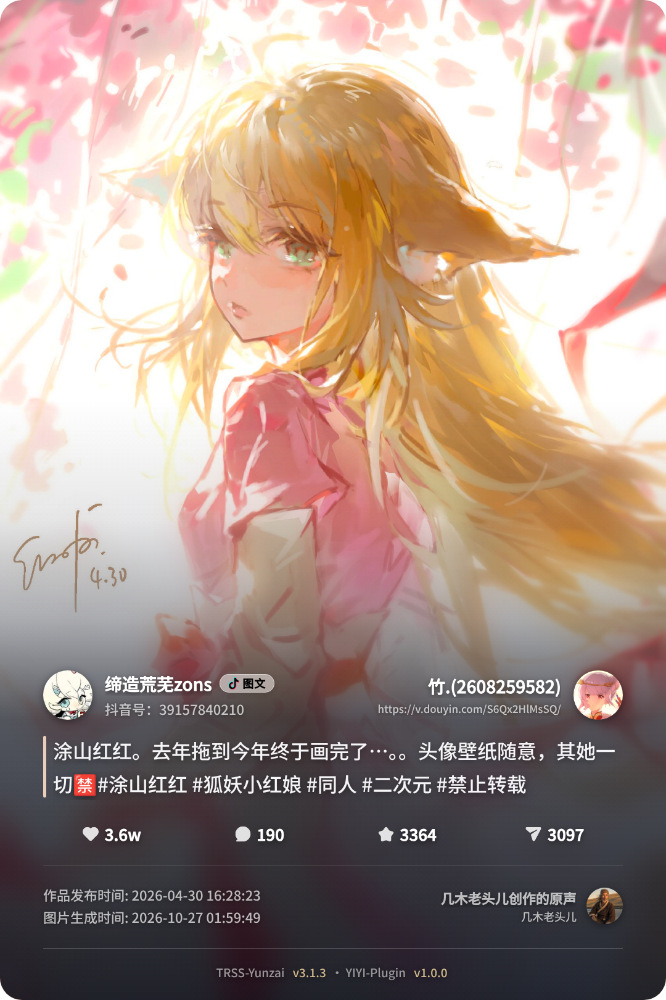
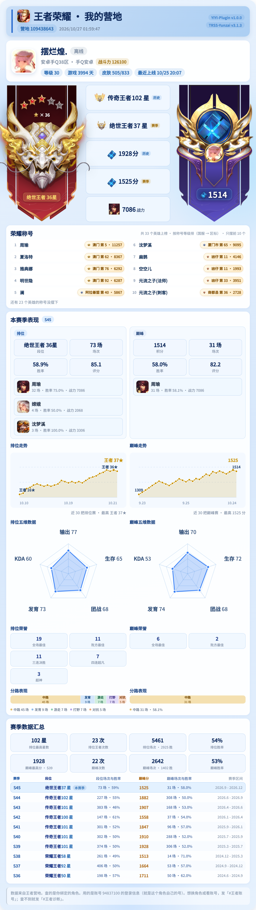
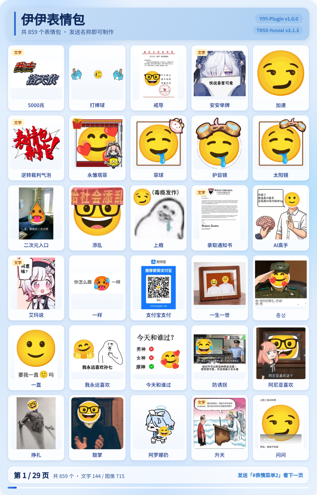
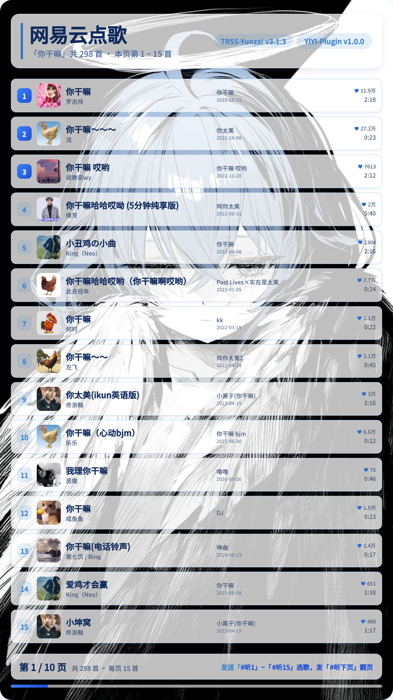
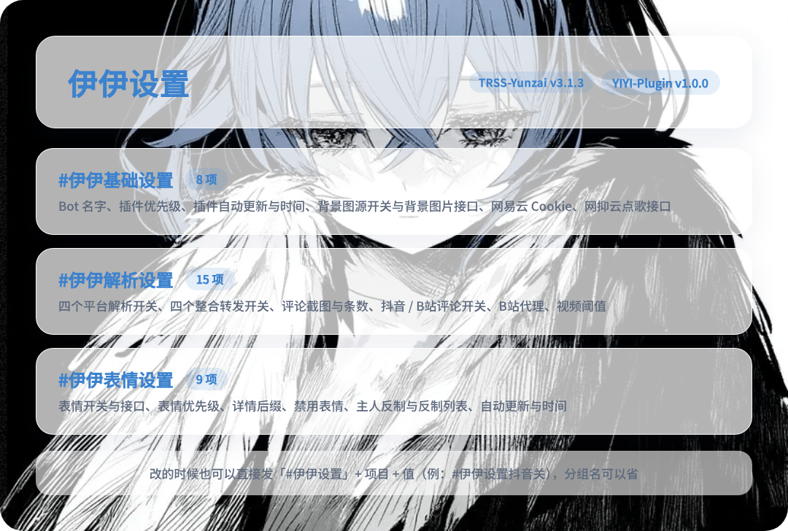
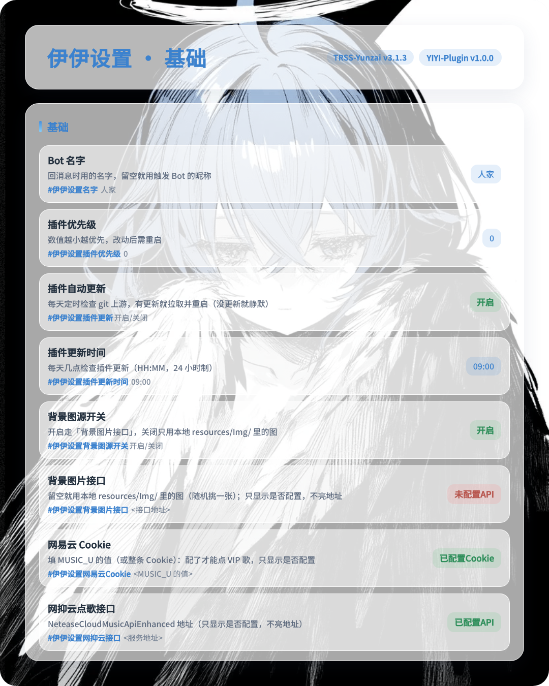
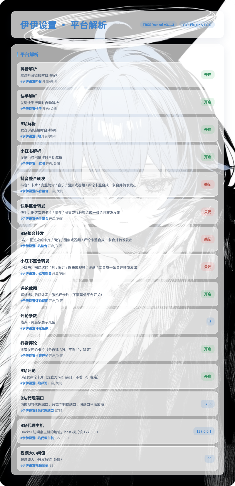
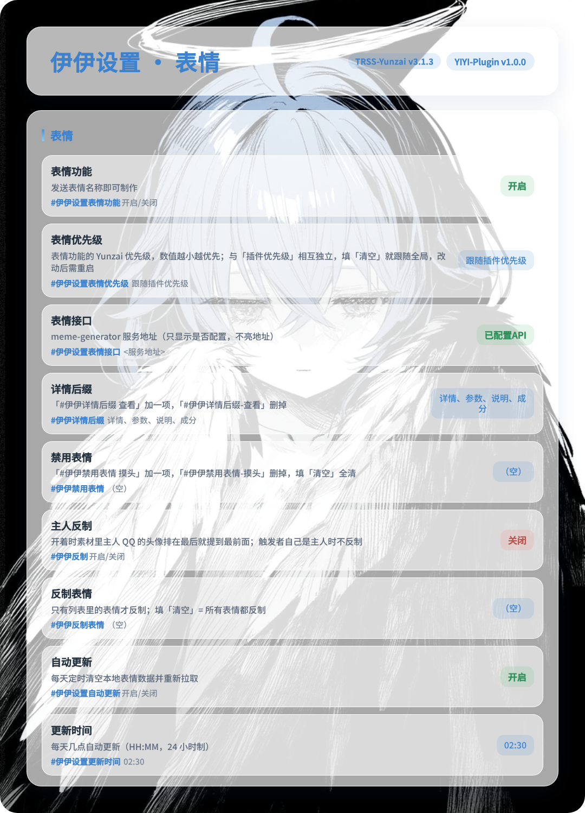

<div align="center">


# 伊伊插件 · YIYI-Plugin

王者荣耀营地卡 / 战绩 / 图鉴 / 推送 · B站 抖音 快手 小红书 链接解析 · 表情包制作 · 网易云点歌

[](LICENSE) [](CHANGELOG.md) [](https://gitee.com/Le-niao/Yunzai-Bot) [](https://gitee.com/IKUN-HUANG/YIYI-Plugin/stargazers) [](https://github.com/IKUN-HUANG/YIYI-Plugin/stargazers)

**仓库**：[Gitee（国内推荐，拉取快）](https://gitee.com/IKUN-HUANG/YIYI-Plugin) ・ [GitHub（备用）](https://github.com/IKUN-HUANG/YIYI-Plugin)

</div>

> **自用说明**：本插件是作者**自用**插件，代码、卡片样式和默认配置都照自己的需求写，只在 **TRSS-Yunzai v3.1.3** / **SnowLuma v2.2.0** 上验证过，其它分支或版本没有逐个测.能用就用，遇到问题请提 [Issues](https://github.com/IKUN-HUANG/YIYI-Plugin/issues).

---

## 安装教程 💡

1. 进 Yunzai 根目录，挑一个源把插件拉进 `plugins`（两个源内容一样，国内推荐 Gitee）：

```sh
git clone --depth=1 https://gitee.com/IKUN-HUANG/YIYI-Plugin.git ./plugins/YIYI-Plugin
```

```sh
git clone --depth=1 https://github.com/IKUN-HUANG/YIYI-Plugin.git ./plugins/YIYI-Plugin
```

2. 装依赖（必做），还是在 Yunzai 根目录：

```sh
pnpm install --filter=yiyi-plugin
```

3. 重启 Yunzai，在群里发 `#伊伊帮助`，能出菜单就装好了.

## 功能介绍 📖

指令不用背，发 `#伊伊帮助` / `#伊伊王者帮助` 会出一张带图的分组菜单.下面把全部功能收成一块，点开再看要哪一类.

> 指令里的「王者」都能写成「王者荣耀」「王者农药」，开头的 `#` 可以不打.

<details>
<summary><b>📖 点开看全部功能</b>　解析 / 王者 / 表情 / 点歌 / 设置</summary>

<details>
<summary><b>🎬 链接解析</b>　B站 / 抖音 / 快手 / 小红书</summary>



<details>
<summary>怎么用</summary>

| 用法 | 说明 |
| --- | --- |
| 直接发分享链接 | 不用打指令，丢到群里就解析 |
| B站 | 视频、图文、专栏，能出视频本体 |
| 抖音 / 快手 | 视频或图集，卡片 + 简介 + 媒体整合成一条转发 |
| 小红书 | 图文或视频 |
| 附带热评卡 | 解析成功后多一张热评卡，`#伊伊解析设置` 里逐平台开 |

</details>

<details>
<summary>相关设置（仅主人）</summary>

| 指令 | 说明 |
| --- | --- |
| `#伊伊解析设置` | 一张卡看四个平台的解析开关、整合转发、评论截图与条数、B站代理、视频大小阈值 |
| `#伊伊设置抖音解析关` | 单条快速开关，B站 / 快手 / 小红书同理，写成 `开` / `关` 都认 |
| `#伊伊设置视频阈值 80` | 超过这个大小只发短链 |

</details>

</details>

<details>
<summary><b>👑 王者荣耀</b>　营地卡 / 战绩 / 英雄图鉴 / 排行 / 推送 / 运维</summary>



<details>
<summary>账号与登录</summary>

| 指令 | 说明 |
| --- | --- |
| `#王者QQ扫码` `#王者微信扫码` | 扫码存一个营地号，一个 QQ 可以存多个号（QQ 区 / 微信区各算一个），登录态只存本机 |
| `#王者扫码取消` | 扫到一半不想扫了，撤掉这次扫码 |
| `#王者绑定 123456789` | 填营地 ID（营地 App「我 - 设置」里能看到），把这个角色挂到自己名下 |
| `#王者绑定说明` | 一张卡讲清「扫码」和「绑定」各管什么：不扫码，别的功能照常能用 |
| `#王者解绑` | 取消绑定 |
| `#王者账号` | 看自己名下有哪些角色、有哪些营地号 |
| `#王者切换账号` / `#王者切换角色 2` | 有多个号 / 多个角色时，换用哪个来查 |
| `#王者隐藏角色 2` / `#王者恢复角色 2` | 把不常看的角色从营地卡里收起来 / 放回去 |
| `#王者删除账号` | 删掉一个存着的号 |
| `#王者校验` | 挨个号验一遍登录态还在不在 |
| `#王者清理过期` | 把已经失效的号清掉 |
| `#王者诊断` | 营地卡查不到数据时，挨个号试查，告诉你卡在哪一步 |

</details>

<details>
<summary>营地卡与战绩</summary>

| 指令 | 说明 |
| --- | --- |
| `#王者营地` | 一张卡看全：当前段位、当前巅峰分、本赛季排位 / 巅峰走势、赛季数据汇总、常用英雄、荣耀称号 |
| `#王者营地 @群友` | 查别人，对方得先绑过 |
| `#王者战绩` | 最近的对局列表，可带页码或对局模式（如 `#王者战绩 2`、`#王者战绩 排位`），也能 `@群友` 查 |
| `#王者战绩详情 3` | 第 3 局的阵容、出装、铭文、伤害占比、MVP，同样支持 `@群友` |
| `#王者段位走势` / `#王者巅峰走势` | 单独把走势图拉出来看，可 `@群友` |
| `#王者在线` | 群里谁在打王者（`#谁在打王者` 同义） |
| `#王者观战开启` / `#王者观战关闭` | 本群观战链接的开关 |
| `#王者观战 @群友` | 看他的观战链接卡在哪 |

</details>

<details>
<summary>英雄与图鉴</summary>

| 指令 | 说明 |
| --- | --- |
| `#王者英雄 李白` | 技能、荣耀称号、推荐出装与铭文、皮肤海报，一张卡看全（`#王者出装 李白`、`#王者铭文 李白` 出同一张卡） |
| `#王者英雄列表` | 全部英雄名单 |
| `#王者常用英雄` | 自己的常用英雄榜，带称号徽章 |
| `#王者英雄战绩 李白` | 单个英雄的全部战绩 |
| `#王者梯度榜` | 英雄强度榜，能挑分路和分段 |
| `#王者皮肤图鉴` | 皮肤海报墙，自己有的亮着 |
| `#王者缺皮肤` | 还差哪几款，最值钱的先列 |
| `#王者装备` | 装备图鉴，也能查单件 |
| `#王者战力` | 英雄在四个大区的战力 |
| `#王者对比 @群友` | 两个人比段位、巅峰、皮肤 |
| `#王者公告` | 官网最新公告，`#王者公告 3` 看详情，`#王者公告下一页` 翻页 |
| `#王者导出战绩` | 把本机存的战绩导成表格 |

</details>

<details>
<summary>排行、群报与推送</summary>

| 指令 | 说明 |
| --- | --- |
| `#王者排行榜` | 本群排位榜和巅峰榜，各前十（`#王者排位排名` / `#王者巅峰排名` 单看一个） |
| `#王者排行榜刷新` | 马上重查，不等自动更新 |
| `#王者日报` / `#王者周报` / `#王者月报` | 把群里这段时间的战绩汇成一张卡 |
| `#王者日报推送开启` / `#王者日报推送关闭` | 日 / 周 / 月报的定时推送开关（`#王者推送状态` 看这三项开没开） |
| `#王者战绩推送开启` / `#王者战绩推送关闭` | 有人开局、打完、上下线时提醒你（`#王者战绩推送状态` 看自己开了哪些） |
| `#王者群推送` | 本群推送的总开关 |
| `#王者群推送 一键开启` | 一次把群推送和日 / 周 / 月报全打开 |
| `#王者公告推送` / `#王者皮肤推送` | 有新公告 / 新皮肤时单独通知你 |

</details>

<details>
<summary>运维（仅主人）</summary>

| 指令 | 说明 |
| --- | --- |
| `#王者运维` | 插件跑得怎么样：账号、订阅、缓存、备份各一份读数 |
| `#王者清理缓存` | 清公开表与翻页缓存 |
| `#王者备份` / `#王者还原` | 备份整个王者数据 / 从备份还原（`#王者还原 2` 按编号选） |
| `#王者黑名单 添加 123456 刷屏` | 拉黑某人，他在王者功能里发什么都不响应；`删除` 放出、`清空` 全清、不带参数看名单 |
| `#王者隐藏主页名单` / `#王者清除隐藏名单` | 被营地标成「主页隐藏」的号单独记一条 |
| `#王者用户统计` | 绑定、授权号、订阅一次摊开 |

</details>

</details>

<details>
<summary><b>😺 表情包</b>　发名字就出图</summary>



<details>
<summary>怎么用</summary>

| 指令 | 说明 |
| --- | --- |
| `摸头` | 直接发名字就做，不用加 `#` |
| `#像素化#20` | 带参数的写法，参数看 `#表情帮助` |
| `#表情菜单` | 分页看全部表情（`#表情菜单 2` 看第二页） |
| `#表情搜索 猫猫` | 按关键词找表情 |
| `#随机表情` | 随便来一张 |
| `#表情帮助` | 表情包怎么用 |
| `#表情更新` | 重新拉一遍表情列表 |

</details>

<details>
<summary>相关设置（仅主人）</summary>

| 指令 | 说明 |
| --- | --- |
| `#伊伊表情设置` | 表情开关、接口、优先级、详情后缀、禁用、反制、自动更新一次看全 |
| `#伊伊详情后缀 查看` | 加一个「详情」后缀（`#伊伊详情后缀-查看` 删掉） |
| `#伊伊禁用表情 摸头` | 禁用某个表情（`#伊伊禁用表情-摸头` 恢复） |
| `#伊伊反制 开启` / `#伊伊反制 关闭` | 主人反制开关，默认关闭 |
| `#伊伊反制表情 摸头` | 只让这些表情反制，清空就全反制 |

</details>

</details>

<details>
<summary><b>🎵 点歌</b>　网易云搜索与听歌</summary>



<details>
<summary>怎么用</summary>

| 指令 | 说明 |
| --- | --- |
| `#点歌 歌名` | 搜 15 首一页 |
| `#听3` | 听本页第 3 首，发链接和语音（`#选3` 同义） |
| `#听下页` / `#听上页` | 翻页 |

</details>

<details>
<summary>相关设置（仅主人）</summary>

| 指令 | 说明 |
| --- | --- |
| `#伊伊设置网易云ck <值>` | 换网易云 Cookie，出厂自带一个可用的，会员歌也能拿到完整播放地址 |
| `#伊伊设置点歌接口 <地址>` | 换点歌接口地址 |

</details>

</details>

<details>
<summary><b>⚙️ 帮助与设置</b></summary>

<details>
<summary>菜单与版本</summary>

| 指令 | 说明 |
| --- | --- |
| `#伊伊帮助` | 带图的总菜单 |
| `#伊伊王者帮助` | 王者那一套（`#王者帮助` 同义） |
| `#伊伊版本` | 看插件版本与更新日志 |
| `#伊伊更新` | 检查更新并拉取，仅主人，更完自动重启（框架给了 `Bot.restart` 才会自动重启，没给就提示你手动重启一次）；只对 `git clone` 装的插件有效，其它装法会告诉你原因和手动升级办法 |
| `#原图` | 引用一张帮助卡再发，拿那张卡的背景原图 |

</details>

<details>
<summary>设置面板（仅主人，改完即生效）</summary>

| 指令 | 说明 |
| --- | --- |
| `#伊伊设置` | 设置入口，列出所有可改的项 |
| `#伊伊基础设置` | Bot 名字、优先级、自动更新与时间、背景图源与接口、网易云 Cookie、点歌接口 |
| `#伊伊解析设置` | 四个平台解析、整合转发、评论截图、B站代理、视频阈值 |
| `#伊伊表情设置` | 表情开关与接口、优先级、详情后缀、禁用、反制、自动更新 |
| `#伊伊设置名字 伊伊` | 单项直接改，项名照面板上写的打，布尔项写成 `开` / `关` |

</details>

</details>

</details>

## 目录结构 🗂️

<details>
<summary>点开看每个目录管什么</summary>

<details>
<summary><code>index.js</code>　入口</summary>

扫 `apps/` 下的文件，把里面的指令注册上；`apps` 读不到只打一行 warn，不影响别的功能.定时任务一律走 `utils/AutoTask.js`，不许模块顶层 `setInterval`.

</details>

<details>
<summary><code>apps/</code>　指令层</summary>

一个平台 / 一个模块一个文件，只写「什么话触发、交给谁处理」：

| 文件 | 管什么 |
| --- | --- |
| `King.js` | 王者全部指令 + 7 个定时任务（推送、群报、缓存清理、登录态保活、公告巡检） |
| `Admin.js` | 帮助菜单、设置面板、自动更新、版本、原图 |
| `Memes.js` | 表情包指令 + 表情数据每日自动更新 |
| `Music.js` | 点歌、翻页、选歌 |
| `Bilibili.js` `Douyin.js` `Kuaishou.js` `Xiaohongshu.js` | 四个平台的链接解析 |

</details>

<details>
<summary><code>models/</code>　业务层</summary>

真正干活的地方，一个模块一个目录：

<details>
<summary><code>King/</code>　王者</summary>

| 子目录 | 管什么 |
| --- | --- |
| `api/` | 营地接口请求、按账号限频、失败重试与降级 |
| `auth/` `login/` `account/` | 扫码登录、账号池、角色归属、绑定 |
| `core/` | 公共常量、业务码、数值与时间格式化 |
| `push/` | 战绩推送：轮询、计划、同账号去重、发送 |
| `report/` | 群日 / 周 / 月报 |
| `watch/` | 观战链接与播放页短链 |
| `view/` | 卡片数据（营地卡、战绩、图鉴、排行、公告…） |

</details>

<details>
<summary><code>Link/</code>　链接解析</summary>

四个平台各自的取数、去水印、出卡；评论截图、合集转发也在这里.

</details>

<details>
<summary><code>Memes/</code> <code>Music/</code>　表情包、点歌</summary>

表情表的拉取与匹配、详情卡、菜单分页；点歌的搜索、翻页、歌词、取流.

</details>

<details>
<summary><code>Admin/</code>　设置与运维</summary>

设置面板的项表与写入、插件自动更新、日志、备份还原、帮助菜单的数据面.

</details>

</details>

<details>
<summary><code>components/</code>　配置与出图</summary>

`Config.js` 读 yaml、合并默认值（缺值 / 坏值自动回落），`ConfigGets.js` 是各处读配置的唯一出口；`Render.js` 把模板渲染成图片.

</details>

<details>
<summary><code>utils/</code>　公共件</summary>

日志、时间、文件、图片（取图 / 缩图 / 背景）、缓存、格式化、版本比对，以及定时任务的壳子.

</details>

<details>
<summary><code>resources/</code>　静态资源</summary>

| 路径 | 内容 |
| --- | --- |
| `Help/` `King/` `Link/` `Memes/` `Music/` | 各模块的卡片模板与样式 |
| `Icon/` | 图标（`King/` 下是英雄、装备、技能、段位） |
| `Img/` | 背景图，随机挑一张 |
| `Img/King/skin/` | 皮肤海报 |
| `Img/Docs/` | README 的插件图标与效果图，不参与出图 |
| `Font/` | 字体（思源黑体、Noto、Symbola） |

</details>

<details>
<summary><code>config/</code>　配置</summary>

`default_config/` 是出厂默认值，随仓库发；`config/` 是你自己那份，首次启动由默认值生成，之后升级不覆盖，也不进 git.

</details>

<details>
<summary><code>data/</code>　数据</summary>

首次启动自动建，存账号、登录态、战绩归档、表情表，细节见下面「数据与隐私」.不入库.

</details>

</details>

## 配置说明 ⚙️

出厂默认值在 `config/default_config/`，**你改的那份在 `config/config/`**，升级不会覆盖.

| 文件 | 管什么 |
| --- | --- |
| `config.yaml` | 插件名、优先级、自动更新、出图格式（`imgType` / `quality`）、图源、表情包、点歌接口 |
| `king.yaml` | 王者：账号限频、并发数、缓存时长、推送时段、观战短链 |
| `memes.yaml` | 表情包的参数表（`#摸头#圆` 那些怎么解析） |

不想动文件就发 `#伊伊设置`，32 项管得到的东西全在里面，`#伊伊设置<项目> <值>` 直接改，改完即生效：



<details>
<summary>三组明细：基础 8 项 / 解析 15 项 / 表情 9 项</summary>

`#伊伊基础设置`



`#伊伊解析设置`



`#伊伊表情设置`



</details>

> ⚠️ 唯一劝你别改的是 `king.minGapMs: 1200`：营地按账号限频，一个号 1.2 秒一次，**调低会让那个号被营地静默 12 小时**.想更快就多挂几个号，别压间隔.

### 王者第一次使用 🔑

| 指令 | 说明 |
| --- | --- |
| `#王者QQ扫码` / `#王者微信扫码` | 扫码登录一个营地号，登录态只存本机，不上传 |
| `#王者绑定 123456789` | 填营地 ID（营地 App「我 - 设置」里能看到），把这个角色挂到自己名下 |
| `#王者营地` | 出卡 |

不扫码也不影响别的功能：查别人、链接解析、表情、点歌照常可用.全部账号相关指令见上面「👑 王者荣耀 → 账号与登录」.

## 数据与隐私 🔒

<details>
<summary>点开看 data/ 里到底存了什么</summary>

首次启动自动建 `data/` 与 `config/config/`，不用手动初始化.

| 路径 | 存了什么 |
| --- | --- |
| `data/King/users/<QQ>.yaml` | 你名下绑了哪些角色、每个角色落在哪个营地 |
| `data/King/archive/<营地号>.yaml` | 每个营地号的登录态与战绩归档 |
| `data/King/groups/<群号>.yaml` | 这个群的推送 / 群报开关 |
| `data/Memes/infos.json` `keyMap.json` | 表情表与关键词映射，`#表情更新` 重拉 |
| `data/Memes/preview/*.png` | 表情预览图，体积的大头，删了会自动重下 |

另外：

- `data/` 与 `config/config/` 里有你的 QQ 号、营地 ID、登录态与 Cookie，都在 `.gitignore` 里，不随代码提交，也不会传到任何地方.
- `cache/` 是随时能删的运行期缓存（公开表、翻页记录、对局回顾），每天 5:30 自动清一遍.
- 插件不收集任何统计信息；营地、B 站等数据都是本机直连接口取的.
- 卡片与截图都在本机渲染，图片不经过第三方.

</details>

## 常见问题 ❓

<details>
<summary>点开看 7 个常见问题</summary>
<details>
  <summary>营地卡查不到数据 / 显示「主页读不到」</summary>

大概率是对方在营地里关了「主页可见范围」，只有他本人的号能看.让角色本人发一次 `#王者QQ扫码`，或者发 `#王者诊断`，插件会挨个号试给你看.

</details>

<details>
  <summary>提示账号被限频</summary>

营地按账号限频，默认 1.2 秒一次.等 12 小时自动恢复；不要为了快把 `minGapMs` 调低，越调限制越久.

</details>

<details>
  <summary>升级后报错 / 少了功能</summary>

用 `git pull` 升级，别用覆盖粘贴.然后在 Yunzai 根目录再跑一次 `pnpm install --filter=yiyi-plugin`，再重启.

</details>

<details>
  <summary>缺依赖 / 表情包或点歌报错</summary>

说明依赖没装全.在 Yunzai 根目录执行 `pnpm install --filter=yiyi-plugin`，看到 `sharp`、`mediabunny` 装好再重启.

</details>

<details>
  <summary>营地卡出图有点慢</summary>

一张营地卡要打好几个营地接口，而营地按账号 1.2 秒限频，所以头一次会慢，之后同一账号十分钟内都走缓存.想快就先查自己的号，或者在面板把 `kingConcurrency` 往上调一两档.

</details>

<details>
  <summary>观战想发自己的短链</summary>

在 `king.yaml` 里填 `watchPageUrl` 与 `watchPageSecret`，指向你自己部署的播放页；不填就发营地原链.

地址**必须写 `http://`**：营地只给 http 的 HTTP-FLV，https 页面拉 http 流会被浏览器按混合内容拦掉，所以那个站点的 80 端口不能跳 https、也不能发 HSTS.页面源码在仓库的 `TEST/Docs/King/watch-page/index.php`（单文件，丢到网站目录即可，不用数据库）.

</details>

<details>
  <summary>群里不推送</summary>

先看 `#王者推送状态`，再确认 `#王者群推送` 开着；日/周/月报还要各自开一次推送开关（`#王者群推送 一键开启` 可以一次全开）.

</details>

</details>

## 联系方式 💬

- 🐧 QQ：[2608259582](https://wpa.qq.com/msgrd?v=3&uin=2608259582&site=qq&menu=yes)
- 💬 QQ 群：[695596638](https://qm.qq.com/q/GxLdaEtkeQ)
- ❤️ 作者：[IKUN-HUANG](https://github.com/IKUN-HUANG)
- 🐛 问题反馈：[GitHub Issues](https://github.com/IKUN-HUANG/YIYI-Plugin/issues) / [Gitee Issues](https://gitee.com/IKUN-HUANG/YIYI-Plugin/issues)

## 友情链接 😊

- [Yunzai-Bot 插件索引](https://gitee.com/Hikari666/Yunzai-Bot-plugins-index)

## 许可与使用声明

### 一、本插件

本插件以 [GNU 通用公共许可证第 3 版（GPL-3.0）](LICENSE) 发布，许可证全文见仓库根目录的 `LICENSE`.

### 二、原项目

王者荣耀部分（营地接口的调用方式、字段结构、卡片编排思路）参考了下面这个项目，**版权归原作者及贡献者**，使用与再分发请遵循其仓库里的许可说明：

| 项目 | 地址 | 与本插件的关系 |
| --- | --- | --- |
| **GloryOfKings-Plugin**（原王者项目） | <https://gitee.com/longhengmu/GloryOfKings-Plugin> | 王者荣耀功能的**思路与接口参考**.本插件是按 Yunzai 插件规范自行实现的代码，未内置该项目中依赖外部第三方服务的部分（独立后端、面板插件、云端图床等） |

### 三、第三方字体

出图用到的字体在 `resources/Font/`，均**以原样分发**，版权与许可归各自作者，不是本插件代码的一部分，也不受本插件的 GPL-3.0 覆盖：

| 文件 | 字体 | 版权 | 许可 |
| --- | --- | --- | --- |
| `SourceHanSansSC-subset.woff2` | 思源黑体（Source Han Sans SC，精简子集） | Adobe / Google | SIL Open Font License 1.1 |
| `NotoSansMath-Regular.woff2` | Noto Sans Math | Google | SIL Open Font License 1.1 |
| `NotoColorEmoji.woff2` | Noto Color Emoji | Google | SIL Open Font License 1.1 |
| `Symbola.woff2` | Symbola | George Douros | 作者声明可免费使用 |

按 SIL OFL 的要求：字体可以随本插件一起分发、也可以嵌入出图结果，但**不得单独售卖字体本身**，也不得把字体改名后当作自己的作品发布.OFL 全文见 <https://openfontlicense.org>.

### 四、游戏数据与素材

1. 战绩、段位、巅峰分等数据经腾讯「王者营地」**公开接口**获取，版权归腾讯所有；本插件只做读取与展示，不修改、不存储对局原始数据用于其他用途（本地缓存见「配置说明」里的 `cache/`）.
2. 英雄头像、皮肤海报、装备与技能图标、称号徽章等美术素材，版权归腾讯及原画作者所有，仅用于群内交流展示.
3. B 站 / 抖音 / 快手 / 小红书的解析结果、表情包模板、点歌封面等，版权归对应平台与原作者所有.
4. 以上内容**仅供学习交流**，请勿用于商业用途；相关权利方如认为有不妥，联系作者会立即移除.

### 五、与 GPL-3.0 的关系

本插件的**代码部分**（`.js` / `.html` / `.css` / 配置与文档）以 GPL-3.0 授权；上面第三、四节的字体、游戏素材、平台内容属于各自的版权所有方，与本插件代码是「聚合」关系，**不因放在同一个仓库里就被 GPL-3.0 覆盖**.分发时请把这几类内容一并保留其原有声明.

## 免责声明 ❗

1. 功能仅限内部交流与小范围使用，请勿将本插件用于任何以盈利为目的的场景.
2. 游戏数据来自腾讯营地公开接口，图片与其他素材来自网络，仅供交流学习使用；如有侵权请联系，会立即删除.
3. 使用本插件带来的账号风险（包括但不限于登录态失效、被限频）由使用者自行承担.
